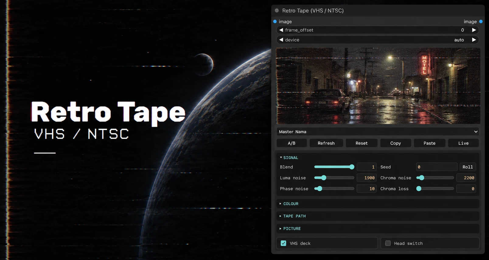
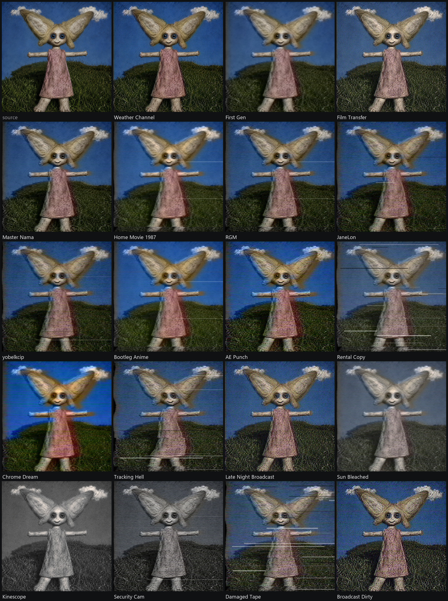

# ComfyUI-RetroTape
A ComfyUI custom node for adding VHS and NTSC-style effects to images and video.

<table>
<tr>
<td valign="top"></td>
<td valign="top"></td>
</tr>
</table>

Includes 19 presets and a live preview inside the node.

## Features

* 19 presets
* Live preview
* Image and video support
* CPU and CUDA
* 28 controls
* JSON copy / paste for settings

Effects include tracking errors, chroma bleed, noise, colour drift, tape warping, dropouts, ghosting, scanlines, interlacing, glow and head switching.

## Install

Clone the repository into `ComfyUI/custom_nodes`:

```bash
cd ComfyUI/custom_nodes
git clone https://github.com/SKBv0/ComfyUI_RetroTape
```

Install the dependencies and restart ComfyUI:

```bash
pip install -r ComfyUI_RetroTape/requirements.txt
```

## Usage

Add **Retro Tape (VHS / NTSC)** from the `RetroTape` category and connect an image.

Three widgets control the node:

* `settings_json` stores the panel settings
* `frame_offset` leave at 0 unless you split a long video into passes
* `device` can be set to `auto`, `cpu` or `gpu`

## Presets



## Live preview

The preview uses the same processing pipeline as the node output.

With `LoadImage`, ComfyUI's `LoadVideo` through `GetVideoComponents`, `VHS_LoadVideo` and `VHS_LoadVideoPath`, the source can be read directly without running the workflow first.

For other inputs, run the workflow once. The incoming image or frames are then cached for preview.

Still images up to about three megapixels are processed at source resolution. Larger images use a reduced preview resolution.

The panel also includes:

* **A/B** to compare with the source
* **Refresh** to render the preview again
* **Reset** to restore the selected preset
* **Copy / Paste** for settings JSON
* **Live / Paused** to enable or disable automatic previews

## Video

Tracking, edge movement and dropouts change over time instead of being generated independently for every frame.

`frame_offset` is only needed if you render a long video in several passes. Leave it at 0 otherwise.

## Performance

`device` can be set to `auto`, `cpu` or `gpu`.

`auto` uses CUDA when available and falls back to CPU if needed.

| Work                      |    CPU |   GPU |
| ------------------------- | -----: | ----: |
| 1024 × 1024, one frame    | 180 ms | 12 ms |
| 1920 × 1080, one frame    | 363 ms | 22 ms |
| 120 frames at 1024 × 1024 | 11.1 s | 1.4 s |

CPU and GPU use different random generators, so noise patterns are not identical. For video, use the same device for the whole render.

## Notes

RGBA inputs keep their original alpha channel. The effect is applied only to the colour channels.

Preview access is limited to ComfyUI's `input`, `output` and `temp` folders. Additional paths for `VHS_LoadVideoPath` can be added with `RETROTAPE_EXTRA_PREVIEW_ROOTS`.

## Credits

Based in part on [ntscQT](https://github.com/JargeZ/ntscqt) by JargeZ, which is based on [composite-video-simulator](https://github.com/joncampbell123/composite-video-simulator) by Jonathan Campbell.

RGM, Master Nama, JaneLon and yobelkcip are ntscQT community presets, copied verbatim from its `builtin_templates.json`.

## License

Apache-2.0. See [LICENSE](LICENSE).
