# vhs-phys

A VHS simulator that models the **physics** of the format instead of layering
filters and noise: a video is recorded as an FM signal onto a simulated tape,
read back through a simulated head with real head-to-tape spacing, passed
through simulated deck electronics, and decoded the way a TV does. Tape damage,
head wear, timebase errors and failing components then *emerge* from physical
parameters (spacing, coercivity, capacitor ESR, tape tension ...). Ahead of the
recorder an optional camera stage takes the picture the way a tube camera did, with
a pickup-tube target that holds charge from frame to frame, so moving highlights
leave lag and comet tails (see [Camera pickup tubes](#camera-pickup-tubes)).

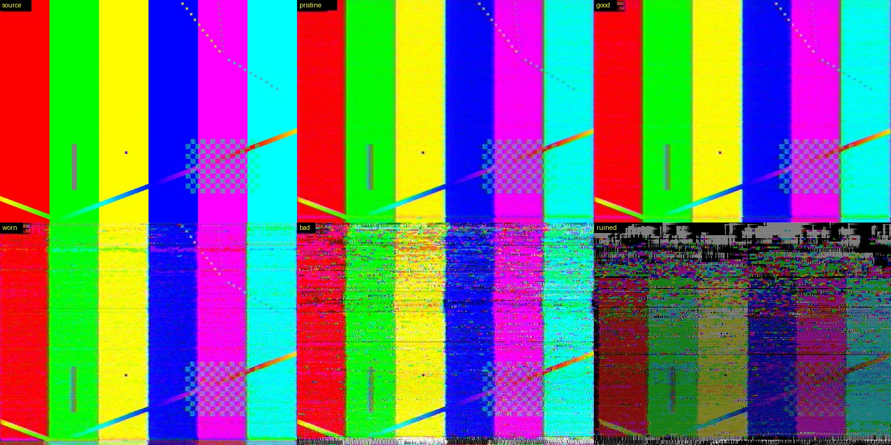
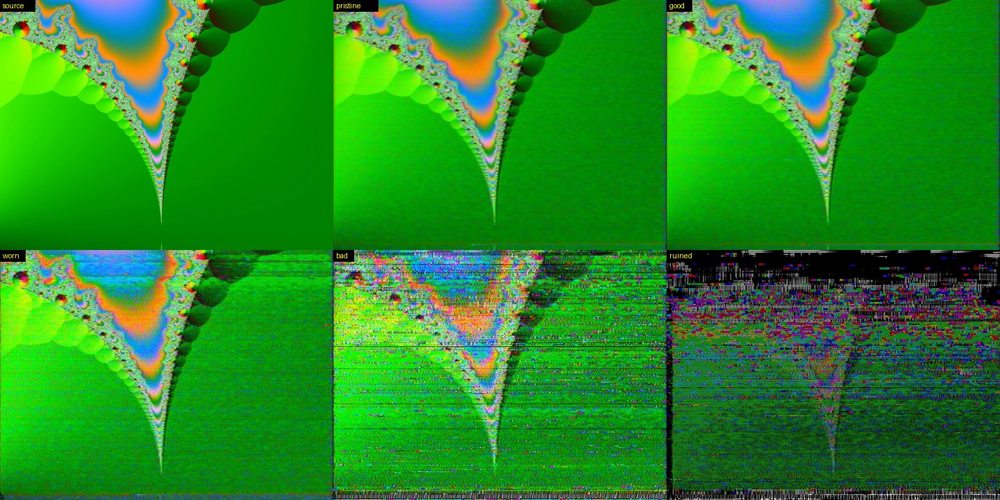

Left to right, top to bottom: source, pristine, good, worn, bad, ruined.

## Download

Get the archive for your system from the [Releases page](https://github.com/allthemalware/vhs-phys/releases), unpack it, and run `vhs-phys` (or `VHS-Phys.app` on macOS). The command line tool `vhsphys` is in the same folder. Install ffmpeg, or place it in that folder. The macOS app is unsigned; right-click it and choose Open the first time. Windows may show a SmartScreen prompt.

This is the standalone prototype. The Rust core (`vhsphys-core`) is written so it
can be wrapped as a plugin later (see `docs/PLUGIN.md`).

## Quick start

Requires a recent stable Rust and `ffmpeg`/`ffprobe` on the PATH.

```sh
cargo build --release
target/release/vhsphys presets
target/release/vhsphys run input.mp4 out.mp4 --preset worn
```

```sh
# a 10 second excerpt, different tape, fixed size, an extra fault on top
vhsphys run in.mkv out.mp4 --preset good --seed 12 --start 30 -t 10 --size 1280x720 \
    --set tape.creases_per_m=0.5 --set deck.supply.hum_ire=8

# a single still (the last frame processed)
vhsphys run in.mp4 still.png --preset bad --frames 40

# inspect / edit every parameter of a preset
vhsphys show worn --condition           # only the high-level knobs, as a config file ready for --config
vhsphys show worn > my_tape.toml        # edit, then:
vhsphys run in.mp4 out.mp4 --preset worn --config my_tape.toml
```

* The same `--seed` gives the same tape (same defects, same timebase wobble).
* `--start SECONDS` places the clip on the absolute timeline. The tape, its
  defects and the timebase error are functions of the absolute frame index, so
  an excerpt rendered with `--start` shows the same picture as the same frames
  of a render of the whole file. (Only the first frame of an excerpt differs a
  little, because it lacks the neighbouring frames the model looks at. A camera
  tube also has a memory that starts when the render does, so with one on, start
  a few frames early; see [Camera pickup tubes](#camera-pickup-tubes).)
* The picture is processed as NTSC by default (29.97 fps, 754x480 active picture);
  `--standard pal` makes it 625-line PAL (25 fps, 740x576), see
  [Television standards](#television-standards). ffmpeg scales to the standard's
  picture and back, so any input size/rate works. The linear audio track
  is processed alongside the picture (or copied untouched with `--audio copy`).
* About 11-14 frames per second on 8 cores (a 30 s 720p clip takes ~80 s; peak memory ~0.5 GB).
  A camera tube ahead of the recorder is slower: about 2 frames per second with a Plumbicon
  (`docs/PERFORMANCE.md`).

## Condition presets

`pristine`, `good`, `worn`, `bad`, `ruined`, single-fault presets
`dry-caps`, `dirty-heads`, `mistracked`, `stretched`, `humid-attic`, and presets that each
isolate one outside influence (see [Interference](#interference-the-outside-world)):
`phone-buzz`, `ham-radio`, `am-station`, `ground-loop`, `magnet-screen`, `magnet-head`, `dimmer`. A preset is a
`Condition` (tape age and storage, head wear/clog, deck age and temperature,
humidity, mains, tracking, tension ...) that the laws in
`crates/vhsphys-core/src/condition.rs` turn into physical parameters:

| Condition | becomes |
|---|---|
| deck age + temperature | electrolytic capacitor C and ESR (life halves per +10 C) -> supply ripple, regulator dropout, hum bars, SMPS herringbone |
| deck age + humidity | resistor drift -> emphasis network error, discriminator detuning, DC error |
| tape age, storage, quality, passes | oxide defect density and size, voids vs debris, creases, roughness, media noise, magnetic loss |
| tape speed | track pitch -> noise, crosstalk, tracking tolerance, audio bandwidth |
| head wear / clog | head half-width and spacing (Wallace loss), gain, azimuth error, one noisy field |
| drum / tension / stretch | timebase spectrum, flagging at the top, head-switch error, track bow and slope |
| tracking error | lateral head offset -> noise band, adjacent-track crosstalk |
| recording deck age | emphasis mismatch, chroma level, FM modulator asymmetry in what was *written* |

Any raw parameter can be overridden (`--set tape.defects_per_mm2=0.03`,
`--set head1.extra_spacing_um=0.9`, `--set hq=true`, `[tape]`/`[deck]`/... tables in a config
file). `[condition]` in a config file refines the preset before it is mapped.

## Television standards

`--standard` chooses the television system the tape is recorded and played in: `ntsc` (the
default), `pal` or `pal60`. In a config file it is a top-level `standard = "pal"` (above the
first table), and `--set standard=pal` does the same; the flag wins over both. An unknown name is
an error.

| | `ntsc` | `pal` | `pal60` |
|---|---|---|---|
| tape | 525 lines, 59.94 fields | 625 lines, 50 fields | 525 lines, 59.94 fields |
| television | NTSC | PAL | PAL |
| frame rate | 29.97 (30000/1001) | 25 | 29.97 (30000/1001) |
| active picture | 754x480 | 740x576 | 754x480 |
| tape speeds | SP, LP, EP | SP, LP | SP, LP, EP |

* `ntsc` is the model described in the rest of this file.
* `pal` is a 625-line recording played into a PAL television: another drum and tape speed, another
  colour-under carrier with the line-by-line V switch, a delay-line colour decoder, and the 50 Hz
  mains. The same tape condition costs more in PAL, because the head moves more slowly across the
  tape. `docs/PAL.md` has the figures and what is not modelled.
* `pal60` is an NTSC tape played on a multi-standard deck into a PAL television. The tape is
  exactly the NTSC one; only the television differs. A phase error that comes off the tape (head
  switching, timebase) still shows as a hue error, only averaged over two lines; one made in the
  television (`decode.tv_phase_deg`) costs saturation instead of hue, as it does in PAL. See
  "PAL-60" in `docs/PAL.md`.

The standard decides which of the two engines in the core runs, so it also decides what is
accepted: EP is refused in `pal` (the 625-line format has no EP); composite output works with all
three standards (3.58 MHz NTSC subcarrier for `ntsc`, 4.43 MHz PAL subcarrier with the V switch
for `pal` and `pal60`). Refused settings are errors on standard error and a nonzero exit, from a
config file and from `--set` alike.

Everything else is the same in every standard. The output has the standard's frame rate whatever
the input's (a 25 fps clip rendered as `ntsc` comes out at 29.97 fps). `--start` and `-t` count
that standard's frames: `-t` is turned into a whole number of frame periods before it is given to
ffmpeg, so that the clip is exactly that many frames long. The sound is played through the same
tape and deck as the picture, so at PAL speed it is that tape's.

`vhsphys show worn --standard pal` prints the PAL parameters of a preset (they include
`standard`); with `--condition` it prints the condition of the preset on that engine, with the
`standard` line above `[condition]` so that the output works as a `--config` file.

The camera pickup tube ahead of the recorder works in every standard: `--camera-tube` takes `off`
(the default), `plumbicon`, `plumbicon-bias`, `plumbicon-act`, `plumbicon-dbc`, `vidicon`,
`newvicon`, `saticon` or `chalnicon`; `--iris-stops N` sets the exposure in stops (positive
overexposes, so highlights leave comet tails). `--camera-layout` chooses `three-tube` or `stripe`,
`--camera-processing` chooses `studio` or `consumer`, `--camera-beam-ratio N` sets the beam
current as a multiple of peak white (default 2), `--camera-blooming N` sets beam-bending
strength (default 0, off), `--camera-temperature DEG_C` and `--camera-cold-start DEG_C` set
operating and switch-on faceplate temperatures, `--camera-idle SECONDS` and `--camera-beam-off SECONDS`
hold the lens capped before the shot and the beam off at its start, and `--camera-spectral` and
`--camera-geometry` enable spectral taking/colour matrixing and scan geometry. The model is in
`docs/CAMERA.md`.

```sh
vhsphys run in.mp4 out.mp4 --preset worn --standard pal
vhsphys run in.mp4 out.mp4 --preset worn --standard pal --camera-tube plumbicon --iris-stops 2
```

## Graphical interface

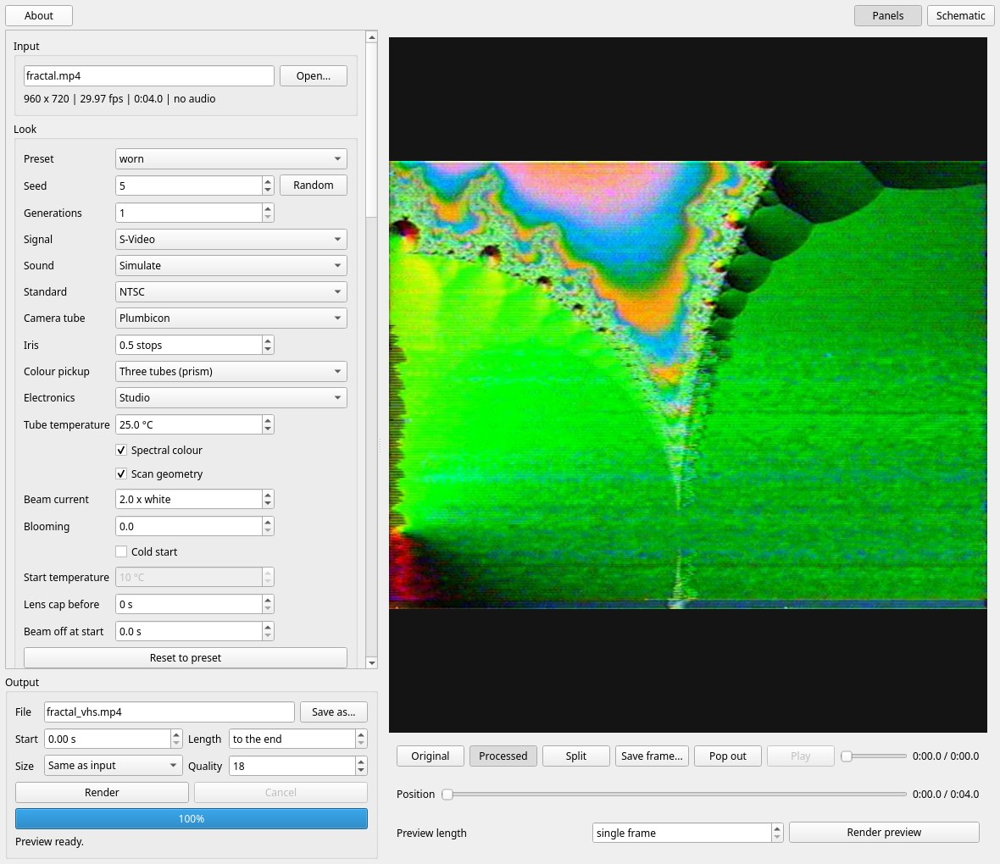

A PySide6 desktop front end in `python/vhsgui` drives the `vhsphys` command line
tool. It requires the built binary (`cargo build --release`), `ffmpeg`/`ffprobe`
on the PATH, and `PySide6-Essentials`.

```sh
python3 -m venv .venv && .venv/bin/pip install -r python/requirements-gui.txt
scripts/vhsphys-gui [input-video]
```

`scripts/vhsphys-gui` runs `python -m vhsgui` inside the repository's virtual
environment. Options of `python -m vhsgui`:

* `input`: optional path to a video file.
* `--binary PATH`: path to the `vhsphys` executable (defaults to `$VHSPHYS_BIN`,
  then `target/release`, `target/debug`, then the PATH).
* `--panels`: start with the settings panels described below (the window
  opens on the schematic by default, see [The schematic](#the-schematic)).
* `--page camera|circuit|outside`: the schematic page to start on (default
  `circuit`).
* `--screenshot PNG`: save a picture of the window and exit (works with
  `QT_QPA_PLATFORM=offscreen`).

The settings panels present the settings on the left and a looped preview on the
right:

* **Settings**: choose the input video, preset, and seed; set the generations,
  the signal, the sound and the television standard; set up the camera (tube, iris, colour
  pickup, electronics, tube temperature, spectral colour, scan geometry, beam
  current, blooming, a cold start with its start temperature, the lens cap before
  the shot and the beam off at its start; the settings after the tube are inert while
  the tube is off, and the start temperature works only while the cold start is on); adjust the
  condition controls across Tape, Heads and drum, Playback deck, Transport and
  tracking, Recording deck and the outside world ("Reset to preset" restores
  them); an Advanced box accepts raw TOML overrides (such as `[tape]` /
  `creases_per_m = 0.5`). The settings column scrolls while output controls
  (destination file, start, length, size, CRF quality, Render / Cancel, and
  progress) stay pinned below.
* **Preview**: choose a position and length (default 2 s, 0 for one frame) and
  press "Render preview". It renders the excerpt and loops playback; Original /
  Processed switches between source and result (key: O; Space plays/pauses).
  Because tape state is an absolute function of frame index, the preview matches
  the final output at that position.
* **Rendering**: writes to a hidden temporary file alongside the target and renames
  it on completion to avoid overwriting or corrupting existing files. Default
  output is `<input name>_vhs.mp4`.

### The schematic

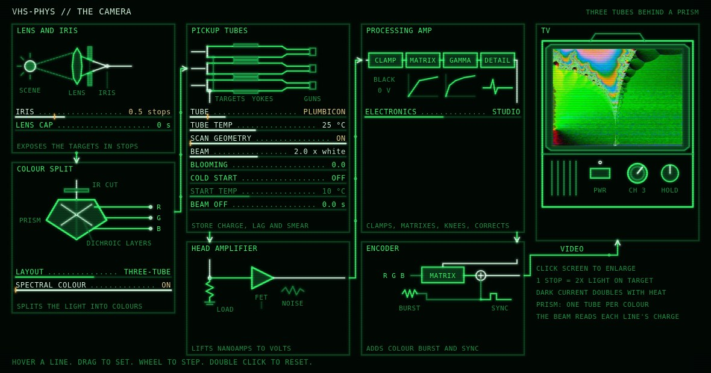
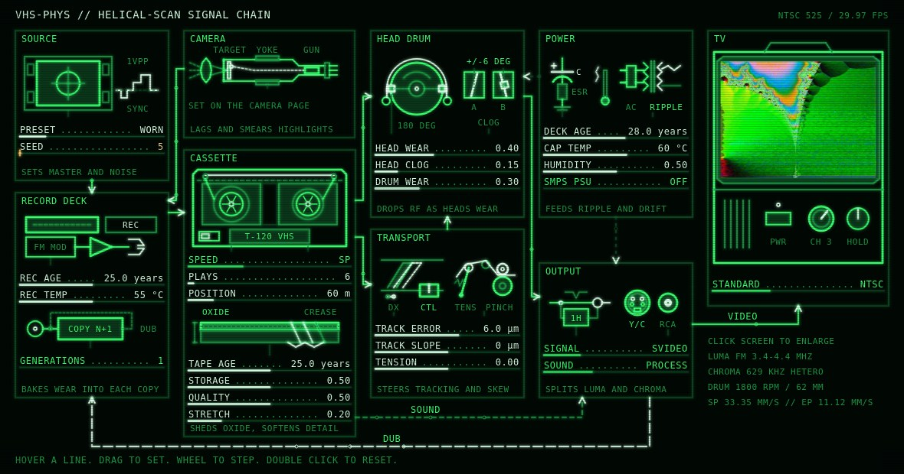
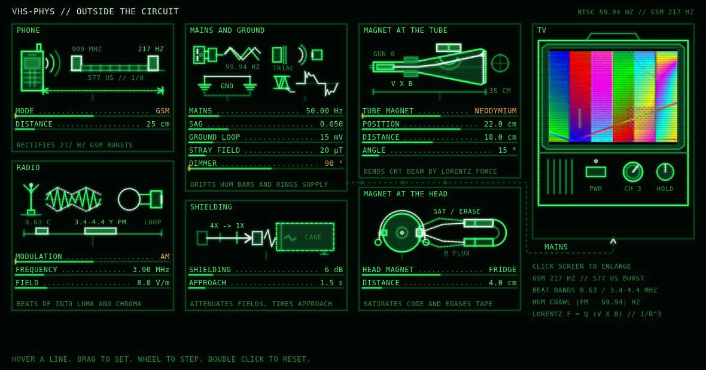

From top to bottom: the camera page (with a Plumbicon camera on), the circuit page and the outside page.

The same controls can be shown as a phosphor-green electrical drawing: the **Schematic** button of the
mode bar replaces the settings column by a drawing of the deck, the cassette and the TV, every control
a labelled line with its value (drag a value, scroll over it, or click it and type). Three pages
share the schematic view (**Camera**, **Circuit**, **Outside**): **Camera** draws the camera ahead
of the recorder (`lens` with `IRIS` and `LENS CAP`, `split` with `LAYOUT` and `SPECTRAL COLOUR`, `tubes` with
`TUBE`, `TUBE TEMP`, `SCAN GEOMETRY`, `BEAM`, `BLOOMING`, `COLD START`, `START TEMP` and `BEAM OFF`, `head_amp`,
`processing` with `ELECTRONICS`, `encoder` and the `tv` preview; the `split` and `tubes` drawings
switch between `three-tube` and `stripe`, and the other camera lines dim and are inert while
`TUBE` is `off`; `START TEMP` works only while `COLD START` is on), **Circuit** draws the recorder
signal chain (its camera block points to the Camera page), and **Outside** draws the things that are
not part of the circuit (see below). All
three pages show the live preview on the TV and edit the same settings as the panels, so the two
views can never disagree.
`python -m vhsgui --schematic [--page camera|circuit|outside] [--screenshot out.png] [input-video]`
(for example `python -m vhsgui --page camera`). The drawing
is data (`python/vhsgui/schematic/*/layout.json`, `glyphs.json`, format in `docs/design/FORMAT.md`,
design notes in `docs/design/SCHEMATIC.md`).

## Interference: the outside world

Things that are not in the circuit but act on it: a phone near the deck, a radio transmitter, the mains
(frequency, ground loop, stray field, a dimmer) and a magnet near the head drum or the picture tube.
Each is a *field at the equipment* (a dipole field, a free-space wave, the mains waveform) that a *coupling*
turns into a voltage at one node of the circuit (loop pick-up, rectification, induction, the Lorentz force);
the existing chain then reacts to it. Nothing is painted over the picture.

* a GSM phone is a 577 us burst every 4.615 ms; the amplifiers rectify it, so the sound buzzes at 217 Hz
  and the picture carries a band 9 lines tall every 72.6 lines; the buzz falls as the square of the distance;
* a radio carrier is induced in the head leads (a loop of 5 cm^2) and goes through the FM discriminator;
  near the luma carrier it makes a diagonal herringbone of fixed spatial frequency, near the colour-under
  carrier coloured stripes;
* the mains is a function of absolute time against the video's own 59.94 Hz, so hum bars crawl at the
  difference (a 50 Hz mains against NTSC video scrolls them fast); a ground loop modulates the video gain;
  a dimmer rings after every firing;
* a magnet saturates the head core and erases the tape (signal drops, the noise does not: snow); at the tube
  it bends the beam by the Lorentz force along its path (the raster shifts, warps, brightens where the lines
  crowd, and changes colour when a beam lands on the next phosphor stripe).

Conditions (`phone_mode`, `radio_mod`, `ground_loop_mv`, `crt_magnet`, ... ) are off by default and in every
older preset; with everything off the output is bit-identical to a build without the module. The derivations,
the equations and the list of estimated coefficients are in `docs/INTERFERENCE.md`.

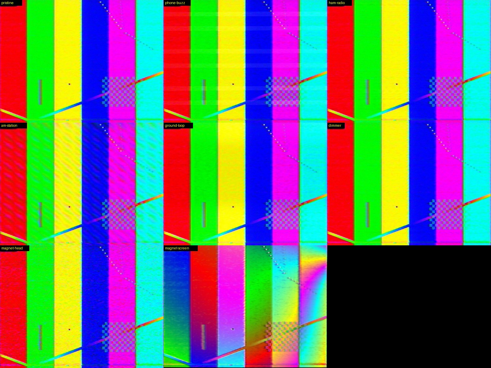

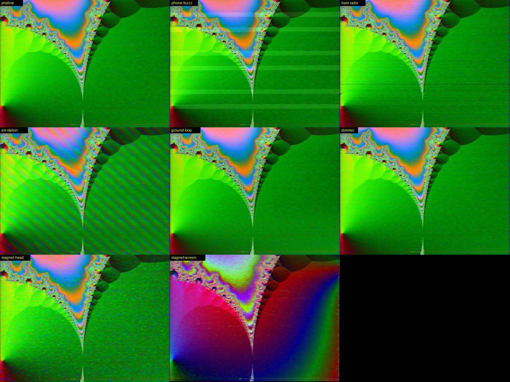

Still frames show the picture side only: the phone's buzz, the mains hum and the dimmer's crackle are in the
sound, the hum bars and the dimmer marks move from frame to frame, and the single-sideband herringbone of
`ham-radio` comes and goes with the speech (a steady carrier, `radio_mod = "cw"`, holds it still).

## Camera pickup tubes

By default the picture goes into the recorder as it is. With a camera tube on, it is first taken the way
a tube camera took it: each colour channel has a target that holds charge from one frame to the next, a
scanning electron beam reads the target line by line at every element's own time, and the signal then
passes the camera's head amplifier and processing amplifier before it is encoded for the recorder. Moving
highlights leave lag and, when they are bright enough, comet tails. All of it acts on the signal as the
camera makes it (`tube.rs`, `camera.rs`, `camera_processing.rs`); the frame is still written once, at the
end, by the picture tube model.

* **Lag.** Near the cathode potential only the faster electrons of the beam can land, so the last of the
  charge on a target element comes off over the next scans. Light bias, a warmer target (dark current acts
  like bias light) and a brighter scene all shorten it. The constants are fitted to the lag figures of the
  data sheets and checked at both frame rates.
* **Comet tails.** The beam is set to twice what peak white needs (`--camera-beam-ratio N`, default 2). A highlight
  beyond that leaves charge the scan cannot take off in one pass; it builds up to the target plate limit and
  drains over several frames as clipped white. A stronger beam shortens the tail, a weaker one lengthens it
  and adds lag. On a Plumbicon the tail ends magenta, because red and blue outlast green.
* **Tube types.** `--camera-tube` takes nine values (below). The four Plumbicon tubes (lead oxide) differ in
  their light bias and in how the beam deals with a highlight; the other four materials differ in transfer
  curve, dark current, target capacitance and traps, and so in how long and how strongly they lag.

| `--camera-tube` | Tube | What it does |
|---|---|---|
| `off` | none | the default: the input is the video signal itself |
| `plumbicon` | XQ1020, PbO | lag, and comet tails behind highlights the beam cannot take off |
| `plumbicon-bias` | XQ1410 | an internal light bias cuts the lag in shadows; the same comet tails |
| `plumbicon-act` | XQ1520 | an anti-comet-tail gun discharges highlights during line flyback, so rated highlights leave no tail |
| `plumbicon-dbc` | XQ3440 | a diode gun with dynamic beam control raises the beam on bright columns, up to 17 times peak signal current |
| `vidicon` | Sb2S3 | a home-camera tube: heavy lag, its own transfer curve (gamma 0.65), 20 nA of dark current, reversible burn |
| `newvicon` | ZnSe/ZnCdTe | sensitive; no photoconductive lag, but a large target capacitance |
| `saticon` | Se-As-Te | low lag, fitted to the RCA BC4908; a strong overload leaves a residue that takes a while to clear |
| `chalnicon` | CdSe | sensitive; lag that is mainly capacitive |

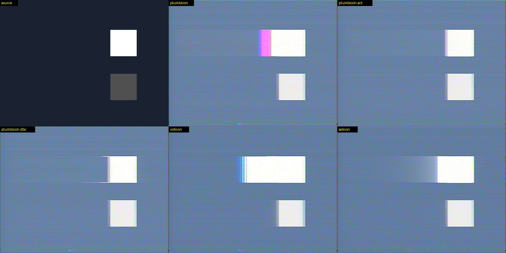

A white box and a dim grey box cross a dark scene (`--iris-stops 3`, so the white box is eight times the light that
gives peak white). Left to right, top to bottom: source, `plumbicon`, `plumbicon-act`, `plumbicon-dbc`, `vidicon`
and `saticon`. The Plumbicon leaves a comet tail behind the white box that ends magenta, the ACT and DBC guns
discharge the highlight and leave only a short lag, the vidicon holds it as clipped white for longer, and the Saticon
smears it softly. The tape is `pristine`, so what differs between the panels is the tube.

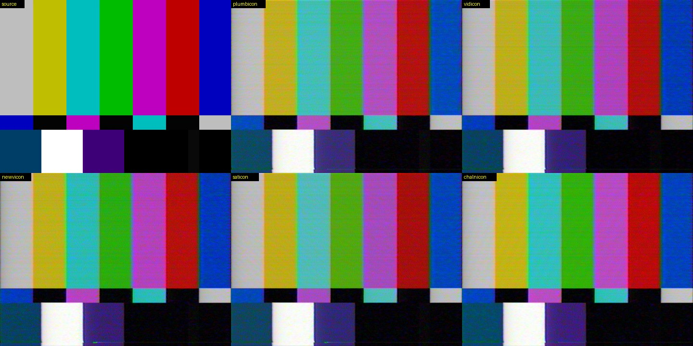

SMPTE colour bars, source first, then each target material with `--camera-spectral --camera-processing consumer`:
the light goes through the infrared filter, the dichroic prism and the material's own spectral response, and the
consumer electronics have no colour matrix to undo the mixing. Left to right, top to bottom: source, `plumbicon`,
`vidicon`, `newvicon`, `saticon`, `chalnicon`. The studio electronics invert the mixing with a matrix for the tube,
so with them the bars come back close to the source.

The rest of the camera, each a flag and a config key (`docs/CAMERA.md`, "Using it"):

* **Exposure** (`--iris-stops N`): the iris in stops. `0` gives peak white; each stop doubles the light, so `2`
  overexposes by a factor of four and `3` by eight. An automation track can move it in time.
* **Temperature** (`--camera-temperature DEG_C`): the target temperature. Dark current doubles every 7.5 to 9.6
  degrees on the materials that have a published law, and acts on the target like bias light.
  `--camera-cold-start DEG_C` switches the camera on with the faceplate at another temperature; it warms to the
  operating temperature with a time constant of 600 s, and the black creeps as it does.
* **Electronics** (`--camera-processing studio|consumer`): the head amplifier (shot, feedback-resistor and FET
  noise, a 5.5 MHz band), clamp, gain, knee, gamma, aperture correction with coring and clip. The studio profile
  has the colour matrix, a knee and vertical aperture correction; the consumer profile has none of these and
  is noisier.
* **Colour pickup** (`--camera-layout three-tube|stripe`): a prism and one tube per colour, or one tube behind a
  cyan and yellow stripe filter whose 3.58 MHz carrier is decoded by frequency separation, as in a home camera.
  The stripe camera has a colour bandwidth near 0.5 MHz, and in a highlight beyond the beam its carrier is lost
  and the picture turns green.
* **Blooming** (`--camera-blooming N`, default 0, off): a target element charged far above its surroundings pulls the
  beams that scan nearby lines towards itself, so a bright highlight spreads into the dark around it. Peak white does
  not bend the beam; no measurement sets the scale of the effect.
* **Spectral colour** (`--camera-spectral`): the scene's light goes through the lens infrared filter, the prism and each
  target's spectral response; without it the colour is ideal.
* **Scan geometry** (`--camera-geometry`): deflection distortion, registration of the three tubes, black and white
  shading, veiling glare, halation, and corner focus, with the studio camera's correctors.
* **Retention**: held charge in lead oxide and the Saticon (more lag at high key, sticking after an overload), reversible
  burn on a vidicon, and warm-up of a cold tube. They all happen on the target, as charge, and nothing is applied to the
  picture after the scan. `--camera-idle SECONDS` (config key `idle_s`) caps the lens with the beam on before the
  first frame, so a cold camera warms under the cap, and `--camera-beam-off SECONDS` (config key `beam_off_s`)
  holds the beam off with the lens open for the start of the shot (a Saticon burns in, a lead-oxide burn is erased).
  The window has both in Settings ("Lens cap before", "Beam off at start") and on the camera page (`LENS CAP`,
  `BEAM OFF`).

```sh
vhsphys run in.mp4 out.mp4 --preset good --camera-tube plumbicon --iris-stops 3
vhsphys run in.mp4 out.mp4 --preset worn --camera-tube vidicon --camera-layout stripe --camera-processing consumer
```

The camera is the slow part: about 2 frames per second at full size with a Plumbicon on 8 cores, and the tube remembers
the past, so a render that starts part-way into a clip (`--start`) needs a few frames of pre-roll before its first
output frame to match a render of the whole clip; a long tail is a few tens of frames. The interactive wizard
(`vhsphys wizard`) asks for the tube, the exposure and the colour pickup, and the window has the camera in its settings and
on its own schematic page. The model, its checks against the data-sheet figures and its sources are in `docs/CAMERA.md`,
the research behind it in `docs/CAMERA_RESEARCH.md`, and the unmeasured values in `docs/MEASUREMENTS_WANTED.md`.

## Tape speeds, generations, composite and sound

### Tape speed

Set in a config file (`[condition]` / `tape_speed = "lp"`), on the command line with `--set condition.tape_speed=lp`, or with the window's "Tape speed" menu (`sp`, `lp`, `ep`). Track pitch is 58 / 28.9 / 19.3 um; the extra noise, crosstalk and tighter tracking tolerance of LP and EP follow from the narrower tracks. LP and EP also follow the format's own record rules: one head's FM carrier sits half a line frequency above the other's, so adjacent-track crosstalk alternates from line to line and the display's comb cancels it, and the colour burst is not doubled at LP (details in `docs/TAPE_SPEEDS.md`).

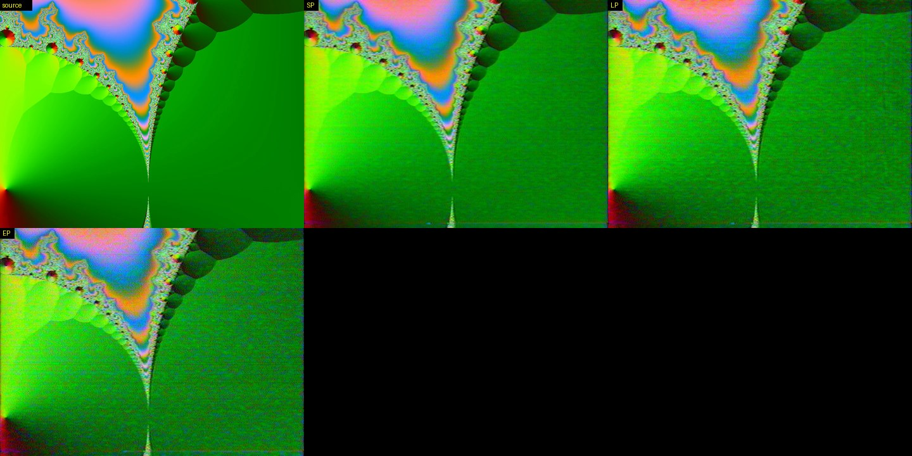

### RF sample rate

Set with `--rf-rate 8x|12x|16x`, top-level `rf_rate = "8x"` in a config file, `--set rf_rate=8x` (the flag wins), or the window's "RF rate" control. `12x` (12 x fsc, three RF samples per baseband sample) is the default and the reference. On 8 threads (754x480 `worn`, Ryzen 7 5800X) `8x` runs at 33.8 fps, `12x` at 27.6 and `16x` at 23.1; on 16 threads 39.0, 31.7 and 27.0. So `8x` is about a quarter faster and `16x` about a sixth slower. On a quiet deck, a flat grey's blue rms is 8.5 levels at `8x`, 2.5 at `12x` (the same at the top and bottom of the picture) and 1.8 at `16x`. On `pristine`, `8x` has about a tenth more colour noise than `12x` (18.2 against 16.6), and at 625 lines about a quarter more luma noise (3.36 against 2.72); its colours stay within about a level of `12x`. `16x` looks the same as `12x` on a real tape. The deck's alignment level differs by up to 9 % at `8x`, and its AGC takes it up. The baseband grid, picture size, camera and sound stay the same. Racks of `[[generation]]` tables run at `12x` only for now.

```sh
vhsphys run in.mp4 out.mp4 --preset worn --rf-rate 8x
```

### Generations

Set with `--generations N` (1 to 8, default 1) or in the window with "Generations". Each generation re-records the previous one's playback on a different tape and deck (its own seed), so defects, wear and timebase differ; the cost is N times. A seed given by `--set seed=N` or in the config file is the seed of the whole chain.


Generations need not share a television standard. A config file with `[[generation]]` tables describes a rack: each generation names its own standard and every pair of neighbours is joined by a `[[link]]` (the direct reference hand-over, separate Y/C, composite, or a standards converter). A change between 625/50 and 525/59.94 needs a `standards_converter` link with a named profile; without one the run is refused before anything is decoded. The converter works on the signal's fields at their true times with the four-field apertures of BBC Research Department Report 1984/20, and only the last deck's output reaches the picture tube (details in `docs/BOUNCE.md`).

```toml
[[generation]]
standard = "pal"

[[generation]]
standard = "ntsc"

[[link]]
type = "standards_converter"
profile = "bbc_four_field"
```

### Composite output

Off by default (S-Video style). Enable with `--set composite.enabled=true --set composite.decoder=notch|comb1h|comb2h` or with the window's "Signal" menu. The deck's Y/C is summed onto the subcarrier of the television's colour system (3.58 MHz NTSC, 4.43 MHz PAL for `pal` and `pal60`) and separated again like a TV does: a notch leaks fine luma detail into colour (rainbow), a comb leaks vertical colour edges into luma (hanging dots), and the dot pattern crawls from frame to frame (details in `docs/COMPOSITE.md`).

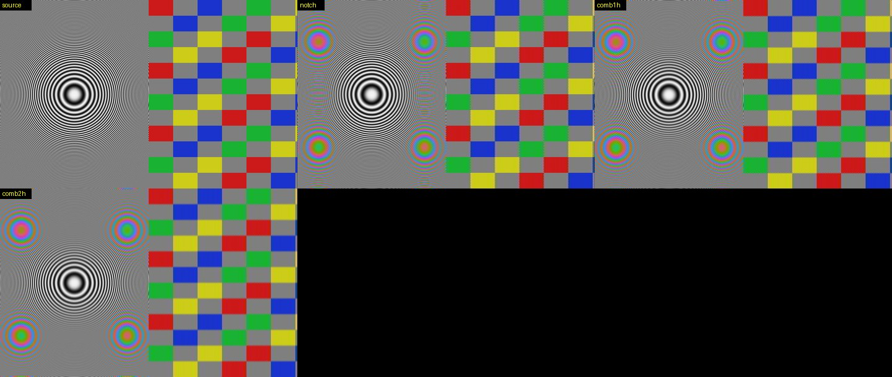

### Sound

Set with `--audio process|copy|none` (default `process`; `copy` leaves the input audio as it was, `none` removes it) or in the window with "Sound" (previews never process sound). The linear audio track is simulated by the same tape and deck as the picture: wow and flutter come from the same capstan error as the picture's timebase, hum from the same supply ripple that makes hum bars, bandwidth from the tape speed (-3 dB at about 10 / 5 / 3.3 kHz at SP / LP / EP), hiss from tape and head noise (about 42 dB SNR on a good SP tape), and dropouts from the same defect statistics (details in `docs/AUDIO.md`). Hi-Fi audio is modelled as an option, off by default: `--set audio.hifi=true` (config: `[audio]` / `hifi = true`). It is a simplified model with head-switch buzz and fallback to the linear track when tracking error exceeds a threshold.

## What is physically modelled

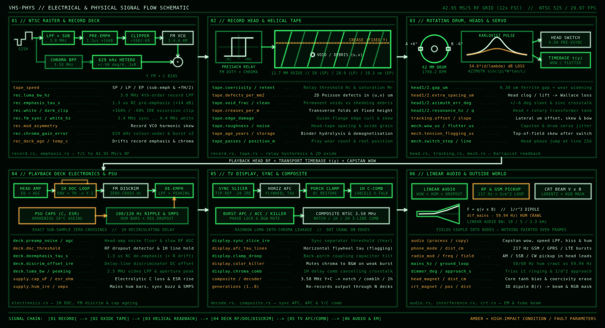

```
frame -> optional camera: iris, prism, pickup-tube targets scanned line by line (charge, lag, comet
         tails, beam), head amplifier noise, processing amplifier (knee, gamma, aperture, clip)
  -> NTSC raster (sync, burst, vsync, half-line field offset)
  -> record deck: luma bandwidth, 1.3 us emphasis, white/dark clip, FM 3.4-4.4 MHz,
                  FM high-pass, colour-under 629 kHz with +/-90 deg line rotation, burst x2
  -> record head/tape: saturating relay (coercivity) on FM + chroma current
                       -> two-state magnetisation, sub-sample reversal times;
                       chroma recorded as duty cycle of the FM bias
  -> tape: defect map in real tape coordinates (helical geometry), spacing field
  -> playback head: Lorentzian readback pulses (Karlqvist/reciprocity), width =
                    gap + transition + spacing, so Wallace's 54.6 d/lambda emerges;
                    azimuth loss and adjacent-track crosstalk; timebase warp
  -> head amp noise + head/transformer resonance (per head)
  -> head switch (6.5 H before vsync) between the two heads' signals
  -> deck: equaliser, slow RF AGC, dropout compensator (1 H recirculating delay),
           limiter + delay-line FM discriminator (exact, continuous time),
           de-emphasis, video low-pass, aperture corrector, supply ripple
  -> display: sync separator (tip referenced), AFC flywheel, back-porch clamp,
              burst APC/ACC/colour killer, 1 H comb for crosstalk
  -> optional composite stage: Y/C summed on the subcarrier and separated by a notch or comb
```

The sound takes the same transport, supply, tape and head parameters (see `docs/AUDIO.md`), and `--generations` chains several decks.

Research notes, parameter provenance and sources: `docs/RESEARCH.md`.
Architecture and numerical decisions: `docs/ARCHITECTURE.md`.
Comparison with other projects and roadmap: `docs/COMPARISON.md`,
`docs/PHYSICAL_MODELLING_RESEARCH.md`, and `docs/ROADMAP.md`.

## Comparison with filter chains (ntsc-rs)

[ntsc-rs](https://ntsc.rs/) is a fast, polished analog-video effect: a signal-processing chain on
YIQ fields that runs in real time and integrates cleanly with editing hosts. `vhs-phys` solves a
different problem: by recording a 42.95 MS/s FM signal onto a 2D helical tape and reading it back
through two physical heads and a deck, faults that are independent sliders in a filter chain emerge
together from one physical parameter.

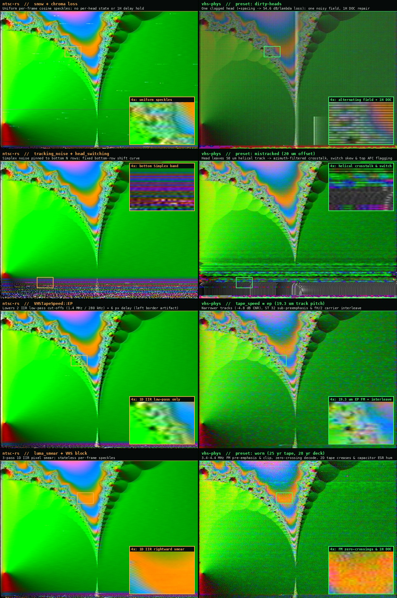
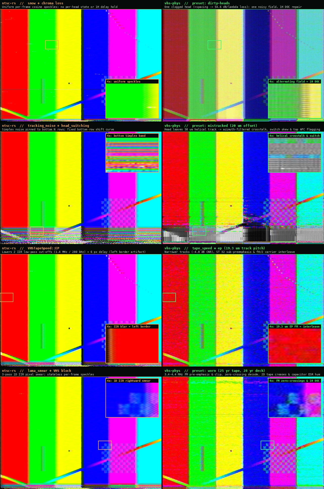

From top to bottom in both comparisons (left: `ntsc-rs` with matched fault modules; right: `vhs-phys`):

1. **Clogged head (`dirty-heads` vs `snow` + `chroma_loss`)**: on a two-head helical drum, dirt on one
   head lifts it off the oxide (`+extra_spacing_um`), attenuating the 3.4-4.4 MHz FM carrier by
   Wallace's $54.6\,d/\lambda$ dB law on *every other field*. The clean head still reads its field
   normally, while the clogged field drops below the RF envelope threshold and triggers the deck's
   1H recirculating delay line (copying luma from the scanline above). A per-frame speckle pass sprays
   independent horizontal dashes across both fields alike.
2. **Mistracking (`mistracked` vs `tracking_noise` + `head_switching`)**: a 20 um lateral tracking
   offset moves both heads across the 58 um helical track boundary into the neighbouring field's
   track. Because the track slants across the tape, the envelope dip, azimuth-filtered crosstalk,
   head-switch phase jump (6.5 lines before vsync) and top-of-field AFC flagging follow the track
   geometry rather than sitting in a fixed Simplex-noise band at the bottom of the frame.
3. **EP / SLP speed (`tape_speed = ep` vs `VHSTapeSpeed::EP`)**: in `ntsc-rs`, switching to EP lowers
   two 1D IIR low-pass cut-offs (1.4 MHz luma, 280 kHz chroma) with a 6-pixel filter delay that
   leaves a dark vertical border on the left edge. In `vhs-phys`, EP narrows the helical track pitch
   from 58 um to 19.3 um (-4.8 dB carrier-to-noise ratio), applies IEC 60774-1 Table 4
   sub-preemphasis, and shifts Head A's FM carrier by $+f_H/2$ so adjacent-track crosstalk
   interleaves line by line.
4. **Worn tape & deck (`worn` vs `luma_smear` + `vhs_settings`)**: a 3-pass causal IIR pixel smear blurs
   high-contrast edges rightward in image space. In `vhs-phys`, edge ringing, white-clipping
   overshoot, zero-crossing FM noise, fixed-height tape creases and 120 Hz capacitor-ESR hum bars all
   come from the 3.4-4.4 MHz FM carrier, the 2D oxide map and the aged power supply.

See [`docs/COMPARISON.md`](docs/COMPARISON.md) for a full breakdown of where each tool is ahead.

## Validation

* Over 450 Rust tests (`cargo test --release`): carrier frequencies match the VHS
  standard, the discriminator is exact, the chroma duty-cycle recording gain
  matches theory, spacing loss follows 54.6 dB per wavelength, the azimuth
  filter follows the sinc law, adjacent tracks are line aligned, creases sit at a
  fixed picture height, point defects slide 1.5 lines per field, repeated playback
  cleans debris, component ageing follows the 10-degree rule, sessions are
  deterministic and reproducible from any start frame, tape speed geometry,
  composite separation, generations, audio bandwidth/wow/hum/dropouts; for the
  outside world: field laws with distance, GSM burst timing, hum bars crawling at
  the mains difference, dimmer marks at the firing times, a magnet's beam
  deflection integrated along the tube, and an unchanged picture with all
  sources off; for the camera: lag, build-up and decay against published
  figures at 50 and 60 Hz, comet tails with and without the ACT and
  diode guns, retention and burn, the colour matrices, the scan geometry and the
  stripe camera's decoder, and an unchanged picture with the tube off.
* Python lab (`python/`): checks the closed-form head physics against a full
  numerical Karlqvist integration, and measures the real CLI end to end.

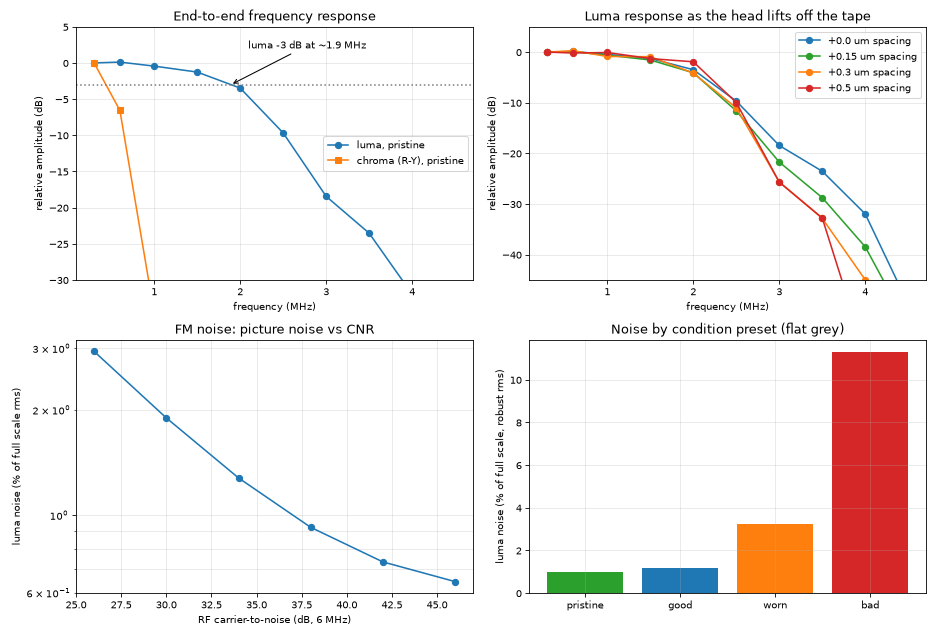

```sh
python3 -m venv .venv && .venv/bin/pip install -r python/requirements.txt
cd python && ../.venv/bin/python -m pytest -q tests
../.venv/bin/python -m vhslab.report ../docs/img/validation.png ../target/release/vhsphys
```

## Known limits of this prototype

* NTSC, PAL and PAL-60 are modelled (see [Television standards](#television-standards)); SECAM and
  S-VHS are not.
* Input is treated as a progressive source (the two fields of a frame come from
  the same image); there is no 59.94 fps field output yet. Field-sequential input exists in the core only (`Session::push_fields(f0, f1)`), while the command line tool still treats each input frame as progressive.
* Print-through and the luma line-delay noise canceller are not modelled.
* The camera has no Trinicon tube, no stripe-camera spectra and no permanent burn damage, and the
  beam spot does not grow with beam current; the lists of what is estimated or unmeasured are in
  `docs/CAMERA.md` ("Known limits") and `docs/MEASUREMENTS_WANTED.md`.
* The ageing laws and several defaults are engineering estimates (tagged `[est]`
  in the source and notes) and are meant to be tuned against real tapes.

## Layout

```
crates/vhsphys-core   physics library (camera, record, tape, head, mech, electronics, decode, pipeline)
crates/vhsphys-cli    `vhsphys` command line tool (ffmpeg pipes)
python/vhsgui         desktop front end (PySide6) for the command line tool
python/vhslab         reference physics, validation report, tuning and plotting tools
docs/                 RESEARCH, ARCHITECTURE, ROADMAP, PLUGIN, PERFORMANCE, COMPARISON,
                      PHYSICAL_MODELLING_RESEARCH, TAPE_SPEEDS, COMPOSITE, AUDIO, INTERFERENCE,
                      PAL, CAMERA, CAMERA_RESEARCH, MEASUREMENTS_WANTED, BOUNCE, design/, images
scripts/gallery.sh    regenerate the gallery images
scripts/features.sh   regenerate the feature images
scripts/interference.sh  regenerate the interference images
scripts/camera.sh     regenerate the camera feature images
scripts/screenshots.sh  regenerate the pictures of the window and of the camera and circuit pages
```

## License

[PolyForm Noncommercial 1.0.0](LICENSE): free for any noncommercial purpose
(personal, research, hobby, education, nonprofit); commercial use needs a
separate licence from the author.

## Roadmap

See [`docs/ROADMAP.md`](docs/ROADMAP.md) for full notes and physics references.

### Currently being worked on
* **PAL deck tuning**: Playback equaliser and head resonance scaled to the PAL carrier; 58 um track pitch reference for CNR.
* **Camera tube limits**: *(Completed)* Scanned target engine, target materials (`vidicon`, `newvicon`, `saticon` refitted to BC4908, `chalnicon`), ACT/DBC/blooming, spectral taking and colour matrices, scan geometry, stripe layout, retention/burn-in/warm-up, beam current, blooming and cold-start settings, and the camera schematic page (`docs/CAMERA.md`).
* **Engine-generic audio I/O**: Generic CLI audio I/O across 525-line and 625-line engines and standard verification checks.
* **Schematic UI integration**: *(Completed)* Television standard on the circuit page, camera tube selection and its settings on the camera page, and drawings that follow the settings (the stripe or prism camera) in the PySide6 schematic view.

### Near-term physical modelling
* **HQ non-linear noise reduction** (SP only): Diode limiter circuit on pre-emphasised signal with inverse filter on playback (`hq = true`). *(Completed)*
* **Magnetic recording beyond the relay**: Switching-field distribution / Preisach hysteresis ($M(H) = M_s \tanh((H \pm H_c)/\Delta H_c)$).
* **Head pole-tip contour ("head bumps")**: Edge flux coupling below 1 MHz affecting colour-under (629 kHz) and audio. *(Completed)*
* **Closed-loop chroma PLL**: Analog phase detector, loop filter, and burst-locked VCO for realistic unlock smear and head-switch phase jumps. *(Completed)*
* **True 59.94 / 50 fps field-sequential input**: Independent field-to-pass mapping for genuine moving interlace comb filtering. *(core API `Session::push_fields` done; the command line tool still reads progressive frames)*
* **Hi-Fi depth-multiplex audio**: Dual FM audio carriers (1.3 / 1.7 MHz) with separate rotating head pair, switching buzz, and fallback muting. *(simplified model done, `audio.hifi`; carrier model to do)*

### Long-term goals
* **Parameter automation**: Time-varying keyframes and automation curves in the standalone app/CLI; per-frame parameter updates in preparation for plugin automation. *(Completed; mechanical crinkles planned)*
* **Cleaner UI**: Refined PySide6 desktop interface, grouped physical controls, dark schematic dock layout, and real-time parameter validation.
* **Walkthrough shell version**: Interactive terminal wizard (`vhsphys wizard`) to guide options without verbose command lines. *(Completed)*
* **Separate viewing window**: Detachable / floating preview viewport for multi-monitor workflows. *(Completed)*
* **Support button & easter eggs**: Period-authentic deck easter eggs (dew sensor trip, tape eject jam, retro OSD modes).
* **Technicolor film source**: Three-strip Technicolor film transferred to VHS through a tube film chain, reusing the camera's spectral taking and registration, with new models for film response, dye-transfer printing and the projector or telecine lamp (first step: a research report on dye spectra and printing).

### Ultra-long-term goals
* **GPU compute architecture**: Compute shaders (WGPU / Vulkan / Metal / DirectX) for Lorentzian pulse rendering, delay-line discriminator, and RF filters to achieve real-time ($\ge 24$ fps) playback.
* **VFX and NLE plugins**: OpenFX (DaVinci Resolve, Nuke, Vegas), Adobe After Effects / Premiere Pro, and Blender compositor integration.
* **Cross-platform release binaries**: Automated CI builds for macOS (`x86_64` and `aarch64` Apple Silicon) and Windows (`x86_64`).
* **Android APK**: Mobile port using NDK and Vulkan compute for retro camera emulation and video processing.
* **Expanded media formats**: Analog formats (Betamax, Video8, Hi8, U-matic) and digital tape simulation (MiniDV / DVCAM macroblocking and dropouts).
* **Multi-generation bounce simulation**: racks of decks of different standards with explicit links and a reference standards converter are in (`docs/BOUNCE.md`); still to come are cable and connector profiles, measured deck and converter profiles and previews of intermediate generations.
* **Real-world tape degradation datasets**: Community RF captures (`vhs-decode`) and measured deck responses to refine physical estimates.

## Support

[](https://ko-fi.com/T5F122USRI)
